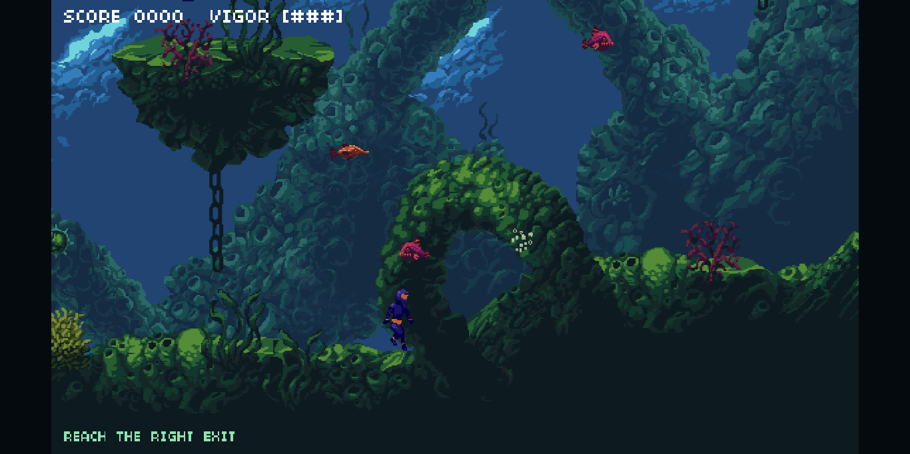

# Underwater Diving — Cave Platformer

**▶ Play it now: https://tthebossbreh.github.io/game-d/**

A single-player side-scrolling platformer built with the **Underwater Diving**
asset pack, on an **Excalibur.js 0.32 + TypeScript + Vite + pnpm** stack.

You play a diver descending a flooded cave: run, jump and boost through the
rock, stomp or dash through fish, avoid mines, collect drifting bubbles and
reach the glowing exit on the far right. Touching the exit loops the run: the
fish and mines return to their starting spots, while you respawn at the level
start with your score and remaining vigor intact.



Score scales with speed: every fish, pickup and exit award is multiplied by a
time bonus that starts at **3x** when the lap timer starts and tapers to **1x**
over 60 seconds. Finish fast to bank more points; both values live in `SCORE`
in `src/game/config.ts`.

Run out of vigor and the run ends: the score resets to zero, a **GAME OVER**
banner flashes, every fish and mine returns to its spawn, and the diver restarts
at the beginning of the cave with full vigor.

## Run it

```
pnpm install
pnpm dev
```

Then open the printed local URL. Enter starts the game.

```
pnpm test       # headless unit tests
pnpm typecheck  # strict TypeScript check
pnpm build      # static production build in dist/
pnpm preview    # serve the built output
```

## Level editor

A browser-based tile editor ships with the game. With `pnpm dev` running, open:

```
http://localhost:5173/editor.html
```

| Tool | Key | What it does |
| --- | --- | --- |
| Brush | `B` | Paint single tiles as you drag |
| Line | `L` | Click-drag to draw a Bresenham line of tiles |
| Box | `R` | Click-drag to fill a rectangle |
| Eraser | `E` | Clear tiles (also works as a brush) |
| Entity | `T` | Click to place the selected fish, mine, pickup or the player |
| Remove | `D` | Click or drag over entities to delete them |
| Stamp | `S` | Drop a whole copied block of tiles in one click |

Other editor features:

- **Stamps** — drag a rectangle in the palette, or `Alt`+drag on the map, to copy a block (entities included when copied from the map). Click or drag with the Stamp tool to drop the whole block; the hovered ghost shows exactly where it lands.

- **Layers** — paint the `main` tiles, the `front` props, or the `collision` grid.
- **Palette** — pick a tile from `tiles.png` / `props.png`; zoom 1×–3×.
- **Entities** — choose from the pack's fish, mines, pickups and the level exit.
- **Undo / Redo** — `Ctrl+Z` / `Ctrl+Shift+Z`, or the toolbar arrows.
- **Pan / zoom** — wheel to zoom, middle-drag or `Space`+drag to pan.
- **Save to project** — writes straight back to
  `src/game/levels/level1.json` while the dev server is running. In a
  production build this falls back to downloading the JSON.
- **Right-click** on the canvas deletes the entity under the cursor.

Because the game reads spawns from the level JSON, anything you place in the
editor (including the player start) takes effect on the next page load.

## Controls

| Action | Keys |
| --- | --- |
| Move | `←` `→` or `A` `D` |
| Jump | `Space`, `↑` or `W` |
| Boost (also your attack) | `Shift`, `X` or `Z` |
| Confirm | `Enter` |
| Mute / volume | `M`, `-` / `+` |

Jumps use low gravity for a tall, floaty arc that clears the cave's ledges.
Boosting into a fish destroys it; so does landing on one.

## Assets

Every runtime asset from the pack is used:

- **Player** — five animation sheets (idle, swim, fast, rush, hurt).
- **Enemies** — `fish`, `fish-big`, `fish-dart`, and `mine` / `mine-small` /
  `mine-big` hazards.
- **FX** — `explosion`, `explosion-small`, `explosion-big`, `enemy-death`,
  `bubbles`.
- **Environment** — `tiles.png` (cave terrain), `props.png` (coral, plants,
  chains), `background.png` and `midground.png` parallax layers.
- **UI** — start-screen art, instruction card and the `04b03` bitmap font
  (auto-decoded into a glyph atlas in `src/game/ui/font.json`).
- **Audio** — two music tracks, three ambient loops and one-shot bubble /
  pickup effects.

The cave level is the pack's original **Level 1** layout: the real collision
bitmap and the `tiles`/`props` tile layers are extracted from the Impact.js
level data into `src/game/levels/level1.json` and rasterised at load time.

> Artwork by **Luis Zuno (@ansimuz)** — public domain, free for personal and
> commercial use. Demo music by **Pascal Belisle**. Bitmap font `04b03` by
> **04 / Yuji Oshimoto**. More free assets at <http://www.pixelgameart.org>.
> Full attribution for every asset lives in [CREDITS.md](CREDITS.md).

## Layout

```
public/assets/            runtime sprites, tiles, sounds and UI art
editor.html               standalone level-editor page
src/
  main.ts                 engine bootstrap + scene registration
  editor/
    main.ts               editor UI: canvas, tools, palette, entities
    tools.ts              pure tile/entity operations (unit-tested)
    editor.css            editor styling
  game/
    config.ts             all gameplay tunables (engine-free)
    assets.ts             asset paths, loader, sprite-sheet helpers
    level.ts              parses the Impact level into solids + spawns
    levels/level1.json    extracted collision + tile data
    physics/              pure AABB helpers and the fixed-step solver
    player/               PlayerState (pure) + PlayerActor (rendering)
    enemies/              EnemyState (pure) + EnemyActor (rendering)
    entities/             pickups and one-shot FX actors
    render/tilemap.ts     rasterises tile layers to a single sprite
    ui/                   bitmap font, glyph atlas and the HUD
    audio/Sfx.ts          music, ambience and effects
    scenes/               Title, Instructions and Game scenes
tests/                    headless Vitest suite
```

### Design notes

- **Engine-free simulation.** `PlayerState`, `EnemyState`, `physics/`,
  `level.ts` and `editor/tools.ts` import nothing from Excalibur, so movement,
  combat, level parsing and editor edits are covered by fast headless tests.
  The `*Actor` classes only render.
- **Fixed 120 Hz step** for deterministic movement.
- **Real level data.** Rather than re-authoring the cave, the pack's own
  collision grid drives physics and its tile layers are pre-rendered once into
  two sprites (`main` behind the actors, `props` in front).
- **Level JSON is authoritative.** Player, enemy, pickup and exit positions all
  come from `level1.json`; the editor writes that same file in dev.
- **Debug handles.** `window.__diving` exposes the `Engine` and
  `window.__editor` exposes the editor state for console poking.

## Next

A room graph with transitions, a ranged tea-thrower analogue, a mini-boss, and
a proper title/credits flow.
